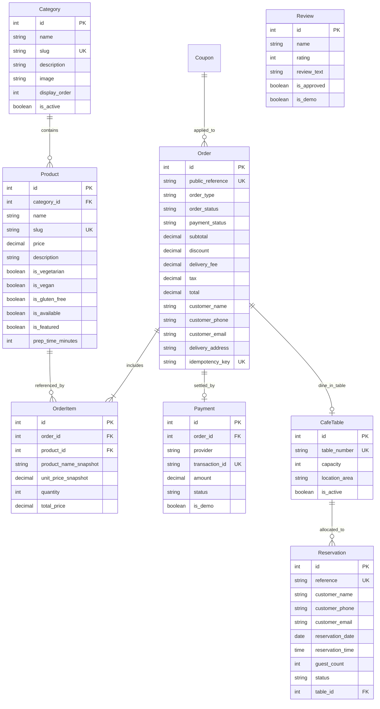

# Aesthetic Aroma — Database Architecture & Schema

This document details the database schema, entity relationships, constraints, and lifecycle state machines powering the Aesthetic Aroma platform.

---

## 🗄️ Database Engine Compatibility

The backend is built with dual-engine flexibility configured via `DB_ENGINE` in `backend/config/settings.py`:

1. **Development & Sandbox (SQLite):**
   - Automatically selected when `DB_ENGINE=sqlite` or during local container testing.
   - Database file stored at `backend/db.sqlite3`.
2. **Production (MySQL 9.x+):**
   - Activated via `DB_ENGINE=mysql` in `backend/.env`.
   - Uses `utf8mb4` character set and `InnoDB` storage engine for ACID transaction guarantees during order generation and table locking.

---

## 📊 Entity-Relationship Diagram



---

## 📋 Table Specifications & Models

### 1. `categories` (`apps.menu.Category`)
Represents menu categories (e.g., Artisan Coffee, European Pastas, Gourmet Pizzas).
- `name` (CharField, max_length=100)
- `slug` (SlugField, unique=True)
- `description` (TextField, blank=True)
- `image` (ImageField, upload_to='categories/')
- `display_order` (PositiveIntegerField, default=0)
- `is_active` (BooleanField, default=True)

### 2. `products` (`apps.menu.Product`)
Strictly vegetarian culinary offerings.
- `category` (ForeignKey -> Category, on_delete=models.CASCADE)
- `name` (CharField, max_length=150)
- `slug` (SlugField, unique=True)
- `price` (DecimalField, max_digits=8, decimal_places=2)
- `description` (TextField)
- `is_vegetarian` (BooleanField, default=True) — Guaranteed 100% vegetarian cafe guarantee.
- `is_vegan` (BooleanField, default=False)
- `is_gluten_free` (BooleanField, default=False)
- `is_available` (BooleanField, default=True)
- `is_featured` (BooleanField, default=False)
- `prep_time_minutes` (PositiveIntegerField, default=15)
- `allergens` (CharField, max_length=200, blank=True)

### 3. `orders` (`apps.orders.Order`)
Customer order records for dine-in, takeaway, and local delivery.
- `public_reference` (CharField, max_length=32, unique=True, db_index=True) — Generated format: `AA-ORD-XXXXXX`.
- `order_type` (`dine_in`, `takeaway`, `delivery`)
- `order_status` (`pending`, `confirmed`, `preparing`, `ready`, `out_for_delivery`, `completed`, `cancelled`)
- `payment_status` (`pending`, `paid`, `failed`, `refunded`)
- `subtotal` (DecimalField, max_digits=10, decimal_places=2)
- `discount` (DecimalField, max_digits=10, decimal_places=2, default=0.00)
- `delivery_fee` (DecimalField, max_digits=10, decimal_places=2, default=0.00)
- `tax` (DecimalField, max_digits=10, decimal_places=2, default=0.00)
- `total` (DecimalField, max_digits=10, decimal_places=2)
- `customer_name`, `customer_phone`, `customer_email`, `delivery_address`, `special_notes`
- `idempotency_key` (CharField, max_length=128, null=True, blank=True, unique=True)

### 4. `order_items` (`apps.orders.OrderItem`)
Historical snapshot of products ordered to prevent price mutation when menu items change.
- `order` (ForeignKey -> Order, related_name='items')
- `product` (ForeignKey -> Product, null=True, on_delete=models.SET_NULL)
- `product_name_snapshot` (CharField, max_length=150)
- `unit_price_snapshot` (DecimalField, max_digits=8, decimal_places=2)
- `quantity` (PositiveIntegerField, default=1)
- `special_instructions` (CharField, max_length=250, blank=True)
- `total_price` (DecimalField, max_digits=10, decimal_places=2)

### 5. `cafe_tables` (`apps.reservations.CafeTable`)
Physical tables within the cafe interior and terrace.
- `table_number` (CharField, max_length=20, unique=True)
- `capacity` (PositiveIntegerField)
- `location_area` (`indoor_ground`, `indoor_mezzanine`, `terrace`, `window_bay`)
- `is_active` (BooleanField, default=True)

### 6. `reservations` (`apps.reservations.Reservation`)
Guest booking requests and allocations.
- `reference` (CharField, max_length=32, unique=True, db_index=True) — Format: `AA-RES-XXXXXX`.
- `customer_name`, `customer_phone`, `customer_email`
- `reservation_date` (DateField)
- `reservation_time` (TimeField)
- `guest_count` (PositiveIntegerField)
- `status` (`pending`, `confirmed`, `rejected`, `completed`, `cancelled`)
- `table` (ForeignKey -> CafeTable, null=True, blank=True, on_delete=models.SET_NULL)
- `admin_notes` (TextField, blank=True)

### 7. `payments` (`apps.payments.Payment`)
Payment audit records linked to orders.
- `order` (ForeignKey -> Order, related_name='payments')
- `provider` (`demo`, `razorpay`)
- `transaction_id` (CharField, max_length=100, unique=True)
- `amount` (DecimalField, max_digits=10, decimal_places=2)
- `currency` (CharField, default='INR')
- `status` (`pending`, `paid`, `failed`, `refunded`)
- `is_demo` (BooleanField, default=True)

---

## 🔄 State Machine & Lifecycles

### Order State Machine
```
[pending] ──(Auto-confirmed on demo payment)──> [confirmed]
                                                    │
                                                    ▼
                                               [preparing]
                                                    │
                                                    ▼
                                                 [ready]
                                                    │
                                      ┌─────────────┴─────────────┐
                                      ▼                           ▼
                             [out_for_delivery]              [completed]
                                      │                           ▲
                                      └───────────────────────────┘
```
- Orders in `pending` or `confirmed` status may be cancelled by the customer via `/api/v1/orders/{ref}/cancel/` or by staff via the Admin Orders portal.

### Reservation State Machine
```
[pending] ──(Staff allocates table & approves)──> [confirmed] ──(Guest arrives)──> [completed]
    │                                                   │
    ├───────────(Staff rejects)──> [rejected]           └────(Guest cancels)───> [cancelled]
    │
    └───────────(Guest cancels)──> [cancelled]
```
